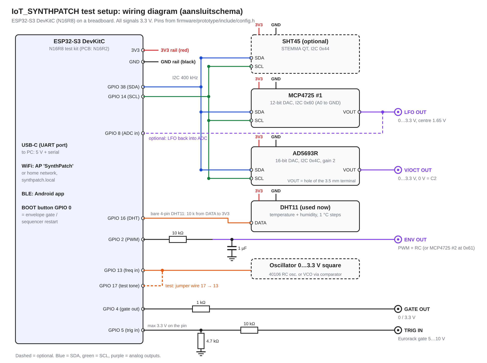

# IoT_SYNTHPATCH

A WiFi-connected Eurorack module: an ESP32-S3 generates LFO, envelope and V/oct control voltages
that you set from a web dashboard (HTTP REST + WebSocket) or an Android app (Bluetooth). It also
measures the frequency of an oscillator, tells played notes apart from tuning drift, and logs that
drift together with the temperature in its own flash memory. No server, broker or Raspberry Pi
needed: the module is the server.

Built for the IoT Technologie course. Problem statement, block diagram, technology choices, rubric
and what works / doesn't work yet: **[docs/iot-project-plan.md](docs/iot-project-plan.md)**.

## Status

* **Current test setup (interim evaluation):** ESP32-S3 DevKitC on a breadboard with a DHT11
  temperature sensor and I2C DACs (MCP4725, AD5693R). Firmware: [`firmware/prototype`](firmware/prototype).
* **PCB:** designed in Altium (main board + analog board), ordered, waiting for parts. See
  [section 4 of the project plan](docs/iot-project-plan.md#4-planned-with-the-pcb-final-evaluation).

## Wiring diagram (test setup)



Pin table and alternatives (SHT45, DS18B20, 2nd MCP4725, oscillator circuits):
[firmware/prototype/WIRING.md](firmware/prototype/WIRING.md). The PCB wiring diagram is the
schematic set in [`hardware/`](hardware).

## Install

You need: an ESP32-S3 dev kit with 16 MB flash, the parts in the diagram, a USB-C cable, and
[VS Code](https://code.visualstudio.com/) with the **PlatformIO** extension (or `pip install platformio`).

1. Clone this repository and switch to this branch:
   ```
   git clone https://github.com/jmartens90/iot_synthpatch.git
   cd iot_synthpatch
   git checkout prototype-setup
   ```
2. Wire the parts as in the diagram above.
3. Build and flash (the first build downloads the ESP32 toolchain):
   ```
   cd firmware/prototype
   pio run -t upload
   pio device monitor        # serial shell, type: help
   ```
4. Optional: the Android app, see [app/README.md](app/README.md) (Qt 6, or `--demo` on the PC
   without an ESP).

## Use

1. **First boot** opens the WiFi access point **SynthPatch** (password `synthpatch`). Join it and
   browse to **http://192.168.4.1**.
2. To use your home network, type in the serial shell: `wifi set <ssid> <password>`. After the
   reboot the dashboard is at **http://synthpatch.local** and the time comes from NTP.
3. On the dashboard:
   * the **Monitor** tab shows the live temperature (°C), humidity (%), frequency, note and cents;
     its chart shows the last 10 minutes live, or 1 h … 46 days from the flash log, with a CSV download;
   * the Synth tab sets the LFO and envelope (the outputs follow), the Seq tab runs the sequencer,
     Patches stores 32 named settings, Outputs shows a scope of the DAC outputs.
4. Quick test without an oscillator: put a jumper wire from GPIO 17 to GPIO 13 and play the web
   keyboard; the test tone is measured and the notes appear in the chart.
5. Useful shell commands: `status` (found sensors and DACs), `log` (stored records), `seq`.

REST API, flash layout, V/oct calibration and a code tour: [firmware/prototype/README.md](firmware/prototype/README.md).

## Repository

| Folder | Contents |
|---|---|
| [`firmware/prototype/`](firmware/prototype) | **Test setup firmware** (PlatformIO): sensors, edge processing, REST + WebSocket + BLE, web dashboard, flash log |
| [`firmware/synthpatch/`](firmware/synthpatch) | Shared engine (LFO, envelope, sequencer, pitch tracker) in plain C++17, with PC tests |
| [`firmware/bringup/`](firmware/bringup) | Hardware test shell for the PCB ([bring-up test plan](docs/bringup-test-plan.md)) |
| [`app/`](app) | Android app (Qt 6, C++/QML) over Bluetooth LE |
| [`hardware/`](hardware) | Altium projects: main board `IoT_SYNTHPATCH.PrjPcb`, analog board `ANALOG/`, Gerbers, BOM |
| [`docs/`](docs) | [Project plan + rubric](docs/iot-project-plan.md), [firmware architecture + UML](docs/firmware-architecture.md), [bring-up test plan](docs/bringup-test-plan.md), wiring diagram |
| `backend/` | Optional, not used: MQTT broker + logger for a possible central server later |

## PCB hardware at a glance

| Block | Part | ESP32-S3 pins |
|---|---|---|
| 8 CV outputs (J10–J17) | 2x DAC124S085 + TL074 | SCLK 18, DIN 17, SYNC 15 / 21 |
| 2 V/oct outputs (J23, J22) | DAC8562 via 74HCT125 + TL074 | SCLK 18, DIN 17, SYNC 8 |
| Mute LEDs DS4–DS11 | TLC5916 | LE 16, OE 2 |
| 8 gate inputs, 8 mute + 2 menu buttons | 3x 74HC165 | PL 3, CP 47, Q7 48 |
| Audio/oscillator input (J26, J28) | PCM1808 | MCLK 35, BCK 36, LRCK 37, DOUT 42 |
| Display + micro-SD | DFR0664 ST7789 2.0" | SCLK 12, MOSI 11, MISO 9, CS 10, DC 6, RST 5, BLK 4, SD CS 7 |
| Encoder | PEC16 | A 39, B 40, SW 41 |
| MIDI in (J20) | HCPL-0700 | RX 13 |
| Temperature / humidity (J21, STEMMA QT) | SHT45 | SDA 38, SCL 14 |
| Status LED DS3 | | 1 |

For the PCB: run the [bring-up test plan](docs/bringup-test-plan.md), then see [firmware/README.md](firmware/README.md).
