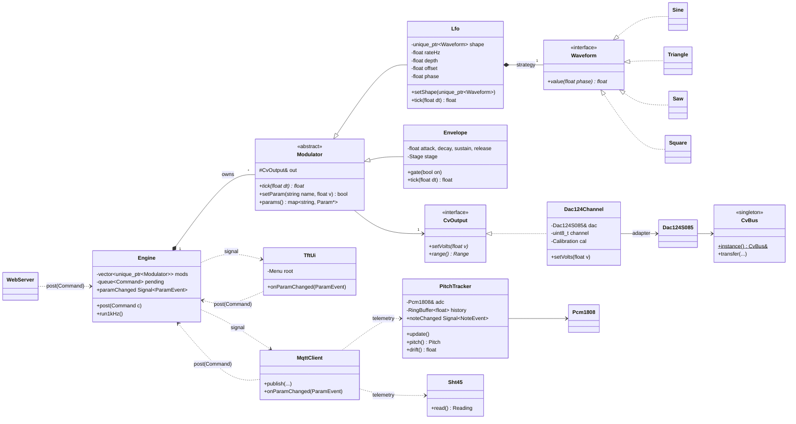

# Firmware architecture (app firmware `firmware/synthpatch`)

The ESP32-S3 is programmed in **C++** (C++17), using the Arduino framework on top of ESP-IDF and FreeRTOS.
The editor is **VS Code + the PlatformIO extension**. A project is split into many files: headers in
`include/`, implementation in `src/`, one class (or a few small related ones) per file. `firmware/bringup`
is deliberately plain (one namespace per chip). The app firmware is designed with the OOP concepts
and patterns from the C++ course, so the course material is used directly.

## Course concepts → where they appear

| Course topic | Used for |
|---|---|
| Encapsulation, classes, getters/setters | Every hardware part is a class with private state: `Sht45`, `Pcm1808`, `Dac124S085`, `ShiftRegisterChain`. Parameters are only changed through setters that clamp the range |
| Inheritance + abstraction (`virtual`, abstract classes) | `Modulator` is an abstract base class; `Lfo` and `Envelope` inherit from it. `CvOutput` is an interface implemented per DAC type |
| Polymorphism (override) | The engine loops over `Modulator*` and calls `tick(dt)`, without knowing whether it is an LFO or an envelope |
| Constructors / overloading, destructor | `Lfo(shape, rateHz)` and `Lfo()`; RAII `BusLock` takes the SPI mutex in its constructor and releases it in its destructor |
| Smart pointers, ownership | The `Engine` owns its modulators as `std::unique_ptr<Modulator>`. Listeners are held as plain references to objects that live for the whole program (no circular ownership). All allocation happens at start-up, never in the 1 kHz loop |
| `std::array`, `std::vector`, `std::map`, `std::queue` | `std::array<CvOutput*, 8>` jacks; `std::vector<std::unique_ptr<Modulator>>`; `std::map<std::string, Param*>` to find a parameter by name from HTTP/MQTT/TFT; `std::queue<Command>` between tasks; a ring buffer for frequency history |
| **Strategy** | LFO waveform: `Waveform` interface with `Sine`, `Triangle`, `Saw`, `Square`; swapped at runtime when the user picks a shape |
| **Command** | Every setting change, whether from the web app, MQTT or the TFT, becomes a `SetParam` command in one queue. The engine task executes them, so there's a single thread-safe path (and undo is easy) |
| **Observer** (signals/slots idea from Qt) | `Signal<T>` with `connect()`: when a parameter changes, the TFT page, the MQTT publisher and the web socket are notified |
| **Factory** | `ModulatorFactory::create("lfo" / "envelope")` builds the right object from a saved or received config |
| **Adapter** | `Dac124Channel` adapts "channel + 12-bit code" of the DAC124S085 to the `CvOutput::setVolts()` interface, including calibration and uni/bipolar scaling |
| **Composite** | TFT menu: a `Menu` contains `MenuItem`s and sub-`Menu`s, all drawn and navigated through one `MenuNode` interface |
| **Singleton** | `CvBus`: there is exactly one shared SPI bus, so one instance guards it |
| **Builder** | `TelemetryBuilder().temperature(t).pitch(p).drift(d).build()` produces the MQTT JSON message |
| UML class diagram | Below; renders on GitHub and goes into the report |

## UML class diagram

## Tasks (FreeRTOS)

| Task | Core | Rate | Does |
|---|---|---|---|
| `engine` | 1 | 1 kHz | executes queued commands, ticks modulators, writes DACs |
| `audio` | 0 | per 43 ms block | I2S read, `PitchTracker::update()` (frequency, note, drift classifier) |
| `ui` | 0 | ~30 Hz | encoder/buttons (74HC165), TFT redraw |
| `net` | 0 | event driven | WiFi, MQTT, HTTP |

Only the `engine` task touches the modulators; the other tasks talk to it through the command queue and the
signals, so no locks are needed on the parameters.

## The app (Qt, desktop + Android)

Chosen: a **Qt Quick** application in `app/`, using `QtMqtt` for live data and commands and Qt Charts for
history (fetched from the backend's REST API). The same code builds for Windows and Android. Its signals and
slots map directly onto the MQTT messages, and the classes follow the same course concepts as the firmware.
The module itself stays fully usable from the TFT.
