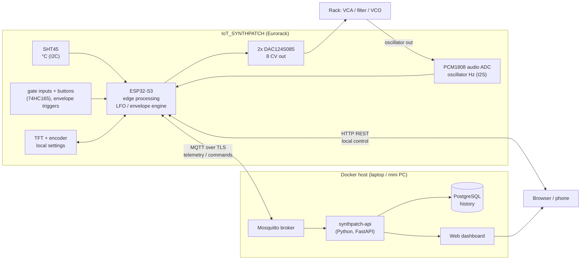

# IoT project plan: rubric mapping, architecture, firmware roadmap

How IoT_SYNTHPATCH meets the IoT course rubric (must-haves 14/20, nice-to-haves +6), what gets built
in which order, and how each point is proven in the demo and the backup video.

## 1. Problem statement and design (must-have, 1 pt)

**Application.** IoT_SYNTHPATCH is a Eurorack module that turns a modular synth into a networked
device. Eight modulation outputs (LFOs and envelopes) and two pitch (V/oct) outputs are generated by
an ESP32-S3 and can be adjusted over WiFi from a web/mobile dashboard, or directly on the module with
the TFT screen and encoder, so it never depends on the external app. The module also listens: an
oscillator from the rack is patched into the PCM1808 audio input, the ESP measures its frequency, and it
tells played notes (sudden jumps) apart from tuning drift (slow change), which is logged next to the
temperature from an SHT45 sensor.

**Problem.** Modulation settings in a modular synth live only in knob positions: you can't see them,
store them, or change them remotely. Analog oscillators also drift out of tune as the case warms up,
and you only notice by ear.

**Target group.** Modular synth players and live performers who want recallable, remote-controllable
LFOs and envelopes, and a monitor that shows when their oscillators drift and how that relates to temperature.

**Block diagram.**

**Technology choices (with the reason, for the report).**

| Choice | Why |
|---|---|
| ESP32-S3-WROOM-1 N16R2 | WiFi, two cores (LFO engine on one, network on the other), enough RAM for a web UI, native USB |
| SHT45 on STEMMA QT | Calibrated digital sensor (±0.1 °C), CRC-checked I2C, plug-in cable, no analog error |
| PCM1808 (24-bit, 48 kHz) | Samples the oscillator directly, so the ESP can measure frequency to a fraction of a cent; ESP is I2S master |
| TFT + encoder on the module | Settings can be changed without the app; the app is an extra, not a dependency |
| MQTT (TLS) for telemetry/commands | Light, push-based, retained state + last will gives online/offline; standard for IoT |
| HTTP REST on the device | Direct local control without the server (stage 10 web page, project topic) |
| Mosquitto + FastAPI + PostgreSQL in Docker | Small, scriptable, own code for the logic (counts as own work), one `docker compose up` |
| Own web dashboard (Chart.js), works on a phone | Needs LFO/envelope editors that a generic tool can't do; a phone browser counts as the mobile app |

## 2. Scope (kept basic on purpose)

1. **Temperature reading:** SHT45 in °C, read every second, averaged, CRC checked.
2. **Oscillator frequency:** a VCO patched into J26 is sampled by the PCM1808. The ESP measures its
   frequency every ~43 ms block (zero crossings with interpolation), plus the nearest note and the
   offset in cents.
3. **Notes vs drift:** the ESP classifies every change in pitch (see below). Note changes become events,
   drift becomes a slow "cents off" value. The dashboard graphs frequency, drift and temperature on one
   time axis, live and as history.
4. **Web / mobile interface for an LFO and an envelope:**
   * LFO: shape (sine, triangle, saw, square), rate (Hz), depth, offset, on a bipolar output (J12, −5…+5 V).
   * Envelope: attack, decay, sustain, release, triggered by gate input J2, on a unipolar output (J10, 0…10 V).
5. **Same settings on the TFT:** encoder turns a value, encoder button selects the parameter, menu buttons SW12/SW13
   switch between the LFO page, the envelope page and a status page (temperature, oscillator Hz/note/cents, WiFi).
   Changes made on the panel are pushed to the dashboard and the other way round.

Not in scope for now: MIDI, V/oct, auto-tune. The hardware supports them, so they can come later.

### Telling notes from drift (edge processing on the ESP)

Pitch is handled in cents (1/100 semitone), so the same rule works at any frequency:
`cents = 1200 · log2(f / 440) + 6900` (MIDI note × 100).

| Signal | How it looks | Rule |
|---|---|---|
| Note played | Jump of ≥ 50 cents between two blocks (< 100 ms), then stable again | **Note event**: log old → new note, restart the stability timer; drift tracking pauses for ~300 ms |
| Vibrato / glide | Fast movement that doesn't settle | Ignored until the pitch is stable again |
| Drift | Pitch is stable (spread < 3 cents over 1 s) and moves slowly: under ~2 cents per second | **Drift**: offset from the nearest equal-tempered note, smoothed (moving average over ~30 s), reported as cents and cents per minute |
| No signal | Level below threshold or no stable period | Nothing logged, status "no input" |

* Drift is measured against the nearest note, so it keeps working whatever note is played. A note change doesn't
  reset the drift value; the new note's offset just continues the same curve.
* Telemetry carries `hz`, `note`, `cents_off`, `drift_cents_per_min` and the temperature; every note change is a
  separate `event` message. The backend stores both, so the history shows drift and temperature side by side,
  with note changes as markers instead of spikes.
* An alarm limit (for example |cents_off| > 10) can show on the dashboard; that is the "action" alongside
  the LFO/envelope control.
* The thresholds (50 cents, 3 cents, 2 cents/s, 30 s) are starting values to tune on the real VCO.
* The ADC input is AC coupled, so this works for audio-rate oscillators, not for slow LFOs or DC voltages.

## 3. Must-haves → features → evidence

| Must-have (points) | What we build | Proof in demo / video |
|---|---|---|
| Problem & design (1) | Section 1, block diagram, technology table, in the README | README walkthrough |
| Sensor & hardware (1.5) | SHT45 temperature in °C; oscillator frequency in Hz via the PCM1808 | Dashboard temperature next to a reference thermometer; a 440 Hz tone reads 440.0 Hz |
| Edge device (1.5) | ESP32-S3 checks and averages the temperature, measures frequency, and classifies notes vs drift on the device; runs the LFO/envelope engine at 1 kHz | TFT status page shows note + cents live; note events appear as you play |
| IoT communication (2) | MQTT: `synthpatch/<id>/telemetry` (temperature, Hz, note, cents off, drift rate) every 2 s, `/event` (note changes), `/settings` (retained), `/status` (online/offline last will), `/cmd/lfo` and `/cmd/env` | MQTT Explorer with live messages |
| Backend & storage (1.5) | Small API service subscribes to MQTT and stores telemetry and setting changes in a database | Show stored history after restarting the stack |
| Dashboard (1.5) | Live temperature, Hz, note, cents off; chart of frequency/drift with temperature, note changes as markers, history range picker | Dashboard on laptop and phone |
| Action / interaction (1) | Set LFO and envelope from the dashboard → the jack output changes (actuator); drift alarm limit | Turn the LFO rate on the phone, the LED next to J12 and the filter follow |
| Full integration (2) | Sensor → ESP → MQTT → backend → DB → dashboard → command → ESP → DAC → sound | One continuous take |
| Code & docs on GitHub (2) | `hardware/` (schematics = wiring diagram), `firmware/`, `backend/`, `docs/`, README with install steps | GitHub link |

## 4. Firmware roadmap (`firmware/synthpatch`)

| Stage | Content |
|---|---|
| A1 Engine | One LFO and one envelope (later 8 outputs), 1 kHz update task, settings saved in NVS |
| A2 TFT UI | LFO page, envelope page, status page; encoder + SW12/SW13; live waveform preview of the LFO |
| A3 Sensors | SHT45 every second with averaging and error handling; PCM1808 frequency, note, cents; note-vs-drift classifier; all on the status page |
| A4 Network | WiFi, MQTT telemetry/settings/commands, reconnect; HTTP page on the ESP as fallback control |
| A5 Backend + dashboard | `backend/`: Mosquitto, API service, database, dashboard page, `docker compose up` |

## 5. Nice-to-haves that come along almost for free

Only claim them after agreeing with the lecturer; each needs to be shown in the demo.

| Nice-to-have | Already there because |
|---|---|
| Self-designed PCB | The two boards in `hardware/` |
| Bidirectional communication | Dashboard sends settings, module sends telemetry and panel changes back |
| Historic values shown | History chart in the dashboard |
| Multiple communication protocols | MQTT + HTTP on the ESP |
| Secrets management | WiFi in NVS, broker credentials in a git-ignored `secrets.h` / `.env` |
| Docker + auto start | `docker compose` with `restart: unless-stopped` |
| Automatic recovery | WiFi/MQTT reconnect; the module keeps running from the TFT when the network is down |

## 6. Demo and video shot list

Record each clip as soon as it works (backup if the live demo fails):

1. Board overview and block diagram.
2. Temperature on the dashboard next to a reference thermometer; finger on the sensor, the chart rises.
3. VCO into J26: play a few notes → note events appear, the drift line stays flat. Then warm the VCO (hair dryer)
   with the same note held → drift line moves, together with the temperature.
4. LFO set from the phone: shape and rate change, the LED and the sound follow.
5. Envelope: send gates into J2, change attack/release from the phone, then from the TFT.
6. History chart: drift and temperature over the session, note markers.
7. TFT only: WiFi off, settings still adjustable on the module.
8. GitHub: README, wiring diagram, install steps.

## 7. Order of work

1. Boards arrive: run [bringup-test-plan.md](bringup-test-plan.md) with `firmware/bringup`.
2. A1 + A2 + A3: the module works standalone with the TFT.
3. A4 + A5: MQTT, backend, dashboard → first full chain. **All must-haves done here.**
4. Docs, README, video clips, rehearse the demo.
