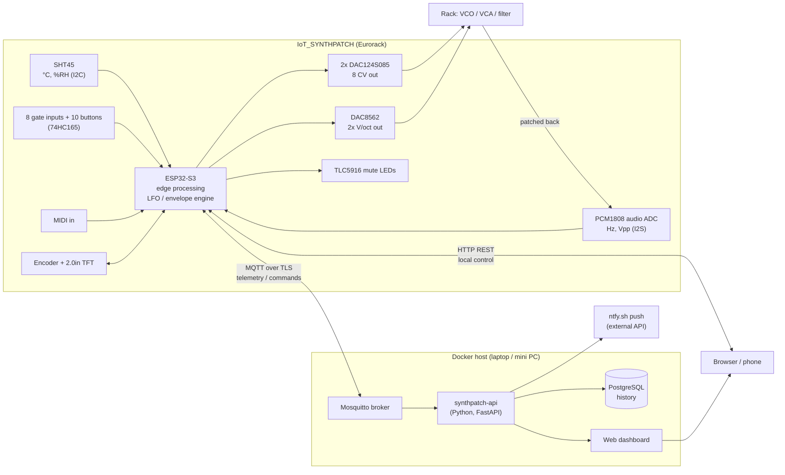

# IoT project plan: rubric mapping, architecture, firmware roadmap

How IoT_SYNTHPATCH meets the IoT course rubric (must-haves 14/20, nice-to-haves +6), what gets built
in which order, and how each point is proven in the demo and the backup video.

## 1. Problem statement and design (must-have, 1 pt)

**Application.** IoT_SYNTHPATCH is a Eurorack module that turns a modular synth into a networked
device. Eight modulation outputs (LFOs and envelopes) and two pitch (V/oct) outputs are generated by
an ESP32-S3 and can be adjusted live over WiFi from a browser dashboard. The module also listens:
an audio input measures the frequency and level of an oscillator in the rack, and a temperature /
humidity sensor tracks the conditions that make analog oscillators drift.

**Problem.** Analog oscillators drift out of tune as the case warms up, and modulation settings live
only in knob positions: you can't see them, store them, or change them remotely. Performers retune by
ear between songs.

**Target group.** Modular synth players, live performers and studios who want recallable, remote
controllable modulation and a tuning monitor for their analog oscillators.

**Block diagram.**

**Technology choices (with the reason, for the report).**

| Choice | Why |
|---|---|
| ESP32-S3-WROOM-1 N16R2 | WiFi + enough RAM/PSRAM for audio analysis and a web UI; native USB; I2S with MCLK output for the PCM1808 |
| SHT45 on STEMMA QT | Calibrated digital sensor (±0.1 °C), CRC-checked I2C, no analog error; temperature is what makes VCOs drift |
| PCM1808 (24-bit, 48 kHz) | Measures real oscillator frequency and level from the rack, with the ESP as I2S master |
| MQTT (TLS) for telemetry/commands | Light, push-based, retained state + last will gives online/offline; standard for IoT |
| HTTP REST on the device | Direct local control without the server (stage 10 web page, project topic) |
| Mosquitto + FastAPI + PostgreSQL in Docker | Small, scriptable, own code for the logic (counts as own work), one `docker compose up` |
| Own web dashboard (Chart.js) | Needs custom views (LFO editors, scope, tuner) that a generic tool can't do. Grafana may be added for raw history, but isn't counted as a nice-to-have |

## 2. Must-haves → features → evidence

| Must-have (points) | What we build | Proof in demo / video |
|---|---|---|
| Problem & design (1) | Section 1 above, block diagram, technology table, in README | Slide/README walkthrough |
| Sensor & hardware (1.5) | SHT45: temperature in °C, humidity in %RH, CRC checked. Second sensor type: audio input frequency in Hz and level in Vpp | Show `sht` / dashboard next to a reference thermometer; 440 Hz tone reads 440.0 Hz |
| Edge device (1.5) | ESP32-S3 does conversion + CRC, moving average, outlier rejection; frequency estimation (zero-crossing with interpolation), Vpp/RMS, note + cents; runs the LFO/envelope engine at 1 kHz | Serial log + dashboard showing processed values (note name, cents), not raw ADC counts |
| IoT communication (2) | MQTT over TLS: `synthpatch/<id>/telemetry` every 5 s, `/state` (retained), `/status` (last will online/offline), `/cmd/#`. Plus HTTP REST on the device | MQTT Explorer showing live messages; pull the network cable from the server → status goes offline |
| Backend & storage (1.5) | `synthpatch-api` subscribes to MQTT, validates, stores telemetry and events in PostgreSQL, exposes `/api/history` | Query a day of history; restart the stack, data is still there |
| Dashboard (1.5) | Live tiles: temperature, humidity, oscillator Hz / note / cents, level, WiFi RSSI, online state; live LFO shapes | Dashboard on laptop + phone |
| Action / interaction (1) | Change LFO rate/shape/depth and envelope ADSR from the dashboard → module outputs change. Alarm: temperature drift → push notification | Turn a rate slider, the LED and a filter sweep follow |
| Full integration (2) | Chain: SHT45/ADC → ESP processing → MQTT → backend → DB → dashboard → command back → DAC → synth sound | One continuous take, see the demo script |
| Code & docs on GitHub (2) | This repo: `hardware/` (schematics, PCB, Gerbers = wiring diagram), `firmware/`, `backend/`, `docs/`, README with install steps, CI build | Link in the submission |

## 3. Nice-to-haves (0.5 each, max 6 points = 12 items)

Each one only counts when integrated, tested, documented and shown. Aim for about 14 so a couple
can fail. **Discuss this list with the lecturer before building them.**

| # | Nice-to-have | How it shows up in this project | Effort |
|---|---|---|---|
| 1 | Self-designed PCB | Two-board 6-layer stack, Altium sources + Gerbers in `hardware/` | Done |
| 2 | CI/CD | GitHub Actions already builds the firmware. To count it needs automatic **tests** (`pio test -e native` unit tests: SHT45 CRC/conversion, volts→DAC codes, 165 bit map, MIDI parser, frequency estimator) and/or automatic **deploy** (GitHub Release with firmware.bin on a version tag, backend Docker image) | Small |
| 3 | Multiple sensor types | SHT45 (°C, %RH) + audio ADC (Hz, Vpp) + gate inputs (BPM from clock) | Small |
| 4 | Bidirectional communication | Dashboard → MQTT `/cmd` → ESP, ESP → telemetry; acknowledged with `/state` | Small |
| 5 | Historic values shown | History charts with time range picker | Small |
| 6 | Secrets management | WiFi in NVS (entered over serial), `secrets.h` and `.env` git-ignored, hashed Mosquitto passwords, no secrets in git history | Small |
| 7 | TLS | Mosquitto on 8883 with own CA; ESP verifies the CA certificate | Medium |
| 8 | Docker | `backend/docker-compose.yml`: mosquitto, api, postgres | Small |
| 9 | Auto start after reboot | `restart: unless-stopped`; ESP boots straight into the app and reconnects | Small |
| 10 | Auto recovery after network/server failure | WiFi + MQTT reconnect with backoff, LWT, sensor re-init after I2C errors | Small |
| 11 | Offline buffering + sync | Telemetry ring buffer in PSRAM/LittleFS while the broker is down, replayed with original timestamps | Medium |
| 12 | Watchdog + error handling | Task watchdog on engine and network tasks, error counters, safe output state on crash | Small |
| 13 | Logging and monitoring | `/status` topic: uptime, heap, RSSI, reset reason, error counters; event log table on the dashboard | Small |
| 14 | Closed control loop | **Auto-tune:** ESP steps V/oct, measures the VCO through the ADC, builds a correction table and applies it. **Temperature compensation:** re-applies tuning when the SHT45 sees drift | Medium, signature feature |
| 15 | Advanced dashboard | Filters by sensor/time, trend lines, alarm limits (temperature, tuning error in cents) | Medium |
| 16 | Data analysis / prediction | Fit tuning drift (cents) vs temperature (°C) from history, predict retune need | Medium |
| 17 | External API | ntfy.sh (or Telegram) push when drift passes the alarm limit | Small |
| 18 | Multiple protocols | MQTT + HTTP REST (+ MIDI) | Done with the above |
| 19 | OTA updates | Firmware upload from the dashboard / ArduinoOTA, signed image check | Medium |
| 20 | Neat housing / finishing | Eurorack front panel with labels | Medium (panel order) |

Group-of-2 must-haves (multiple nodes, secrets, secure external access, history) only apply if you
work in a pair. Secrets and history are covered anyway; secure external access could be a Tailscale
or Cloudflare tunnel if needed.

## 4. Firmware roadmap

`firmware/bringup` (this PR) is the hardware test shell. The real firmware goes in
`firmware/synthpatch`, built up in stages, each one demoable on its own:

| Stage | Content | Rubric |
|---|---|---|
| A1 Engine | 8 modulators: LFO (sine/tri/saw/square/S&H, rate, depth, offset, phase, gate sync) on bipolar outs, ADSR envelopes on unipolar outs triggered by gates J2–J9; 1 kHz task on core 1; settings in NVS | Action |
| A2 Panel UI | TFT pages (outputs, tuner, network), encoder + menu buttons; mute buttons mute outputs with LED feedback | Edge |
| A3 HTTP REST | `GET/PUT /api/mod/<n>`, `/api/status`, `/api/scope`, web page served from the ESP | Communication, action |
| A4 MQTT + TLS | Telemetry, retained state, LWT, commands; reconnect with backoff | Communication, TLS, recovery |
| A5 Sensors | SHT45 with averaging + error handling; oscillator monitor (Hz, note, cents, Vpp) + downsampled waveform on request | Sensor, edge |
| A6 Closed loop | Auto-tune and temperature compensation of V/oct | Closed loop |
| A7 Robustness | Watchdog, offline buffer, OTA, status/log topic | Several nice-to-haves |

Backend (`backend/`): Mosquitto config with TLS and ACL, `synthpatch-api` (FastAPI, paho-mqtt,
SQLAlchemy), PostgreSQL, dashboard static files, `docker-compose.yml`, `.env.example`.

**MQTT topics (draft).**

| Topic | Direction | Payload |
|---|---|---|
| `synthpatch/<id>/telemetry` | ESP → | `{"ts":…, "temp_c":23.41, "rh":41.2, "osc":{"hz":261.7,"note":"C4","cents":+3.1,"vpp":9.8}, "rssi":-58}` |
| `synthpatch/<id>/state` (retained) | ESP → | current modulator settings |
| `synthpatch/<id>/status` (retained, LWT) | ESP → | `online` / `offline` + uptime, heap, errors |
| `synthpatch/<id>/cmd/mod/<n>` | → ESP | `{"shape":"sine","rate_hz":0.5,"depth":1.0}` |
| `synthpatch/<id>/cmd/tune` | → ESP | `{"target":"C4"}` starts auto-tune |
| `synthpatch/<id>/event` | ESP → | gate/tune/alarm events |

## 5. Demo and video shot list

Record each of these as a separate clip as soon as it works (backup if the live demo fails):

1. Board overview and block diagram (30 s).
2. Sensor: dashboard temperature next to a reference thermometer, breathe on the SHT45 → RH rises.
3. Oscillator monitor: VCO into J26, dashboard shows Hz, note and cents; turn the VCO's tune knob.
4. Action: change an LFO rate and shape on the dashboard, hear the filter sweep change; LED follows.
5. Full chain in one take: warm the VCO / case (hair dryer), the drift shows in cents and in the history chart,
   alarm fires (push on the phone), auto-tune runs, tuning back to ±2 cents.
6. Robustness: stop the broker container → module keeps running and buffers; start it → data back-fills,
   status goes offline/online.
7. History: pick a time range, show temperature vs drift trend.
8. GitHub: README, CI badge green, wiring diagram (schematic PDF).

## 6. Order of work

1. Boards arrive: run [bringup-test-plan.md](bringup-test-plan.md) stages 0–11 with `firmware/bringup`.
2. A1 + A3 (engine + HTTP): this already demonstrates the project topic locally.
3. Backend skeleton (Docker, Mosquitto, API, DB) + A4 MQTT → first full chain. **Lock in the must-haves here.**
4. Dashboard (live + history + controls).
5. A5/A6 tuner and auto-tune, then the robustness items.
6. Docs, README, video clips, rehearse the demo.
