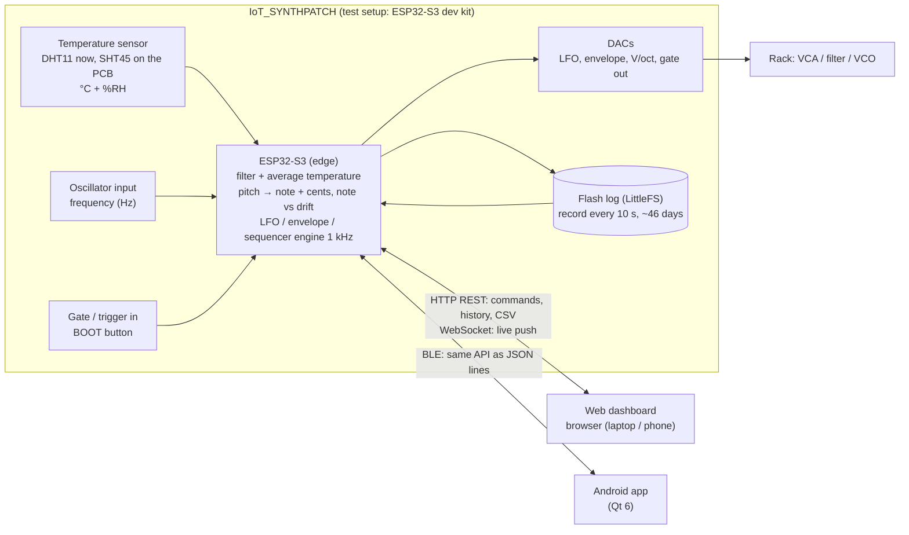
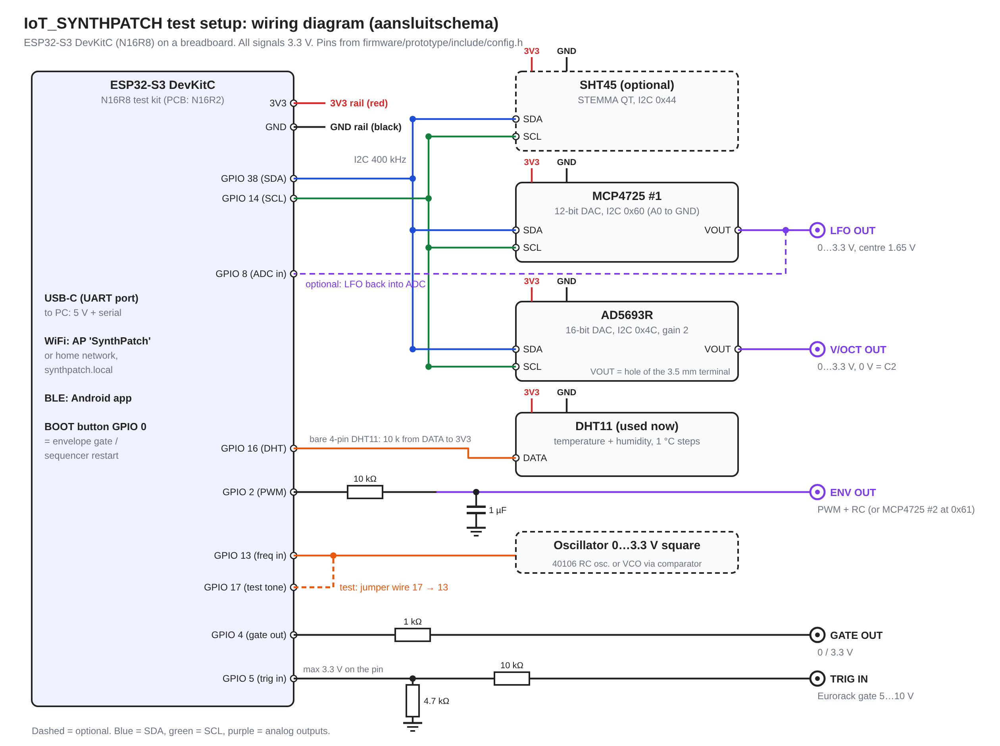

# IoT project plan: problem statement, test setup, rubric

How IoT_SYNTHPATCH meets the IoT Technologie rubric: the problem statement, the **current test setup**
(ESP32-S3 dev kit on a breadboard, used for the interim evaluation), the evidence per criterion, and
what is planned once the PCB is assembled.

## 1. Problem statement

**Application.** IoT_SYNTHPATCH is a Eurorack module that turns a modular synth into a networked
device. An ESP32-S3 generates modulation voltages (LFO and envelope) and a pitch voltage (V/oct).
You set them over WiFi from a web page in the browser, or over Bluetooth from an Android app. The
module also listens: it measures the frequency of an oscillator from the rack, tells played notes
(sudden jumps) apart from tuning drift (slow change), and logs that drift together with the
temperature, so you can see how the oscillator detunes as the case warms up.

**Problem.** Modulation settings in a modular synth live only in knob positions: you can't see them,
store them or change them from a distance. Analog oscillators also drift out of tune as the case
warms up, and you only notice it by ear, too late.

**Target group.** Modular synth players and live performers who want recallable, remote-controllable
LFOs and envelopes, and a monitor that shows when their oscillators drift and how that relates to
the temperature.

### Block diagram

The module is its own server. A phone or laptop connects directly to it; no broker, database
server or Raspberry Pi is needed.

### Technology choices

| Choice | Why |
|---|---|
| ESP32-S3 | WiFi + Bluetooth LE on one chip, two cores (synth engine on one, network on the other), enough flash (16 MB) to store weeks of data |
| **HTTP REST** on the ESP (chosen IoT protocol) | Every browser speaks it, so there is no app to install and no extra server. Commands (set LFO rate, save patch, ...) are simple request/response. Easy to test with a browser or `curl` |
| **WebSocket** (port 81) next to REST | Push instead of polling: the ESP sends the live values every second and the outputs every 20 ms, so the dashboard is live without hammering the device with requests |
| **Storage on the device** (LittleFS ring buffer in flash) | The user has no server at home. One 16-byte record every 10 s gives ~46 days of history (needed: ≥ 2 weeks), survives reboots and power cuts, and is served over REST and as CSV |
| NTP time (or the browser's clock in access-point mode) | Each log record needs a real timestamp |
| Access-point fallback "SynthPatch" | Works in a classroom or on stage without a router |
| BLE to an Android app (Qt 6, C++/QML) | Control from a phone without WiFi; uses the same API as the web page. Qt and C++ also come from the C++ course |
| Why not MQTT + a database server | A broker plus a database (Mosquitto, PostgreSQL) needs an always-on computer next to the synth. For one module talking to one user, that is overkill. The MQTT code stays in the firmware, off by default, in case a central server is wanted later |

## 2. Current test setup (interim evaluation)

The PCB parts are not all in yet, so the course demo runs on an **ESP32-S3 DevKitC (N16R8)** on a
breadboard with I2C breakout boards in place of the PCB chips. It runs the same engine and pitch
tracker as the final module (`firmware/synthpatch/lib/engine`).

(Vector version: [img/prototype-wiring.svg](img/prototype-wiring.svg). Pin table:
[firmware/prototype/WIRING.md](../firmware/prototype/WIRING.md).)

| Function | Test setup | On the PCB later |
|---|---|---|
| Temperature (sensor) | **DHT11** on GPIO 16, °C + %RH (SHT45 or DS18B20 are detected automatically if present) | SHT45 on J21 (STEMMA QT, ±0.1 °C) |
| Oscillator frequency | Frequency counter on GPIO 13 (0…3.3 V square). Test: jumper from the test tone on GPIO 17 | PCM1808 audio ADC (I2S) |
| LFO output | MCP4725 0x60, 0…3.3 V | DAC124S085 + TL074, 8 jacks, 0…10 V or ±5 V |
| Envelope output | PWM on GPIO 2 + RC (10 kΩ, 1 µF) | DAC124S085 + TL074 |
| V/oct output | AD5693R 0x4C, 16-bit, 0…3.3 V | DAC8562 + TL074, 0…10 V or ±5 V |
| Gate out / trigger in | GPIO 4 / GPIO 5 (max 3.3 V, divider for Eurorack levels) | Gate inputs J2–J9 via 74HC165 |
| Local control | BOOT button = gate | TFT + encoder + buttons |
| Dashboard | Web page `http://synthpatch.local` (or `192.168.4.1` in AP mode), Android app over BLE | Same |

Build, flash and usage: [firmware/prototype/README.md](../firmware/prototype/README.md).

## 3. Interim evaluation: rubric and evidence

| Criterion (points) | What is there | Where to see it | Status |
|---|---|---|---|
| **Problem statement** (0.5) | Application, problem, target group, block diagram, technology choices with reasons | Section 1 of this file | Done |
| **Sensor** (0.5) | DHT11: temperature in °C and humidity in %RH, read every second; plausibility check (range + spike filter) | Dashboard Monitor tab, shell `status` | Works on hardware |
| **Edge device** (0.5) | ESP32-S3 averages 10 readings and rejects spikes; turns the measured frequency into note + cents and classifies note changes vs drift (`PitchTracker`); runs the LFO/envelope engine at 1 kHz | Dashboard chart (drift, note markers), `firmware/synthpatch/lib/engine/PitchTracker.h` | Works on hardware |
| **IoT communication** (1) | HTTP REST API (`/api/live`, `/api/log`, `/api/set`, ...) + WebSocket push of live data; real sensor values arrive in the browser; commands go back and change the DAC outputs | Browser dev tools (Network tab), `curl http://synthpatch.local/api/live` | Works on hardware |
| **Dashboard** (0.5) | Web page with live temperature (°C), humidity (%), frequency (Hz), note + cents, a chart that updates every second, history ranges from flash (1 h … 46 d), CSV download; plus LFO/envelope/sequencer controls | `http://synthpatch.local`, Monitor tab | Works on hardware |
| **Code & documentation** (1) | Code on GitHub (branch `prototype-setup`), README with install and usage, wiring diagram (section 2), code tour | This repository | Done |

### What works and what doesn't yet

Works:

* Temperature + humidity from the DHT11, live on the web page and in the log.
* Frequency measurement, note + cents, note vs drift (tested with the test tone jumper).
* LFO, envelope and V/oct set from the web page or the Android app; the outputs follow.
* Patch memory (32 named patches in flash), step sequencer with a piano roll.
* WiFi with automatic reconnect, access-point fallback, Bluetooth app.

Not yet / limitations:

* **PCB not assembled yet**: the test setup uses breakout boards, outputs are 0…3.3 V instead of
  Eurorack levels, and there is no TFT/encoder on the prototype (the web page has the same settings).
* **Long-term flash log** is implemented but not yet tested over a full two weeks.
* In access-point mode there is no NTP, so logging only starts once a web page has sent the
  browser's time; after a reboot in AP mode it waits for the page again.
* The DHT11 has 1 °C steps, so slow drift vs temperature is coarse until the SHT45 is fitted.
* The frequency input needs a clean 0…3.3 V square wave; a real synth oscillator needs a comparator
  (the PCB uses the PCM1808 instead).

## 4. Planned with the PCB (final evaluation)

Short version of what the assembled module adds, per rubric criterion:

| Criterion | Planned with the PCB |
|---|---|
| Sensor | SHT45 (±0.1 °C, CRC-checked) on J21; real oscillator signal through the PCM1808 audio ADC (J26/J28) |
| Edge device | Pitch tracking from the PCM1808 audio samples (fractions of a cent); 8 CV outputs + 2 V/oct from the same engine; gate inputs J2–J9 trigger the envelopes |
| IoT communication | Same HTTP REST + WebSocket API, BLE for the app; no change needed in the dashboard |
| Dashboard | Same web page and app, extended to 8 outputs; TFT + encoder on the module show the same settings, so it also works without a phone |
| Actuator | Eurorack-level outputs (0…10 V / ±5 V) through the TL074 stages, LEDs per output, mute buttons |
| Code & docs | Altium schematics as the wiring diagram (PDF export), [bring-up test plan](bringup-test-plan.md), firmware `firmware/synthpatch` |
| Nice-to-haves | Self-designed PCB (two boards, ordered), bidirectional communication, history from the flash log, multiple protocols (HTTP, WebSocket, BLE), automatic recovery (WiFi reconnect, AP fallback) |

## 5. Edge processing: telling notes from drift

Pitch is handled in cents (1/100 semitone), so the same rule works at any frequency:
`cents = 1200 · log2(f / 440) + 6900` (MIDI note × 100).

| Signal | How it looks | Rule |
|---|---|---|
| Note played | Jump of ≥ 50 cents between two blocks (< 100 ms), then stable again | **Note event**: log old → new note, restart the stability timer; drift tracking pauses for ~300 ms |
| Vibrato / glide | Fast movement that doesn't settle | Ignored until the pitch is stable again |
| Drift | Pitch is stable (spread < 3 cents over 1 s) and moves slowly: under ~2 cents per second | **Drift**: offset from the nearest equal-tempered note, smoothed (moving average over ~30 s), reported as cents and cents per minute |
| No signal | Level below threshold or no stable period | Nothing logged, status "no input" |

* Drift is measured against the nearest note, so it keeps working whatever note is played.
* The live data carries `hz`, `note`, `cents_off`, drift and the temperature; note changes show as
  markers in the chart instead of spikes.
* The thresholds (50 cents, 3 cents, 2 cents/s, 30 s) are starting values to tune on a real VCO.

## 6. Demo video (optional) shot list

1. Problem statement and block diagram (section 1), 30 s.
2. The breadboard setup next to the wiring diagram.
3. Dashboard: temperature and humidity live; finger on the sensor, the value rises.
4. Browser dev tools: the REST calls and WebSocket messages arriving.
5. Turn the LFO rate on the web page (and on the phone): the output and the scope follow.
6. Test tone into the frequency input: play notes, note markers appear; drift stays flat.
7. History range (1 h / 24 h) from the flash log, CSV download.
8. What doesn't work yet (section 3) and what the PCB adds (section 4).
