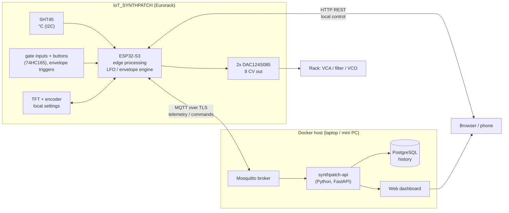

# IoT project plan: rubric mapping, architecture, firmware roadmap

How IoT_SYNTHPATCH meets the IoT course rubric (must-haves 14/20, nice-to-haves +6), what gets built
in which order, and how each point is proven in the demo and the backup video.

## 1. Problem statement and design (must-have, 1 pt)

**Application.** IoT_SYNTHPATCH is a Eurorack module that turns a modular synth into a networked
device. Eight modulation outputs (LFOs and envelopes) and two pitch (V/oct) outputs are generated by
an ESP32-S3 and can be adjusted over WiFi from a web/mobile dashboard, or directly on the module with
the TFT screen and encoder, so it never depends on the external app. A temperature sensor logs the
conditions in the case next to the output voltages.

**Problem.** Modulation settings in a modular synth live only in knob positions: you can't see them,
store them, or change them remotely. Analog gear also drifts as the case warms up, and nobody logs that.

**Target group.** Modular synth players and live performers who want recallable, remote-controllable
LFOs and envelopes, plus a view of what the module is outputting.

**Block diagram.**

**Technology choices (with the reason, for the report).**

| Choice | Why |
|---|---|
| ESP32-S3-WROOM-1 N16R2 | WiFi, two cores (LFO engine on one, network on the other), enough RAM for a web UI, native USB |
| SHT45 on STEMMA QT | Calibrated digital sensor (±0.1 °C), CRC-checked I2C, plug-in cable, no analog error |
| TFT + encoder on the module | Settings can be changed without the app; the app is an extra, not a dependency |
| MQTT (TLS) for telemetry/commands | Light, push-based, retained state + last will gives online/offline; standard for IoT |
| HTTP REST on the device | Direct local control without the server (stage 10 web page, project topic) |
| Mosquitto + FastAPI + PostgreSQL in Docker | Small, scriptable, own code for the logic (counts as own work), one `docker compose up` |
| Own web dashboard (Chart.js), works on a phone | Needs LFO/envelope editors that a generic tool can't do; a phone browser counts as the mobile app |

## 2. Scope (kept basic on purpose)

1. **Temperature reading:** SHT45 in °C, read every second, averaged, CRC checked.
2. **Graph temperature with the voltage:** the module publishes temperature together with the voltages it is
   putting out on J10…J17 (it knows them exactly, it generates them). The dashboard shows both live and as history
   on one chart (temperature on one axis, volts on the other).
3. **Web / mobile interface for an LFO and an envelope:**
   * LFO: shape (sine, triangle, saw, square), rate (Hz), depth, offset, on a bipolar output (J12, −5…+5 V).
   * Envelope: attack, decay, sustain, release, triggered by gate input J2, on a unipolar output (J10, 0…10 V).
4. **Same settings on the TFT:** encoder turns a value, encoder button selects the parameter, menu buttons SW12/SW13
   switch between the LFO page, the envelope page and a status page (temperature, WiFi, IP). Changes made on the
   panel are pushed to the dashboard and the other way round.

Not in scope for now: MIDI, V/oct, the audio ADC, auto-tune. The hardware supports them, so they can come later.

## 3. Must-haves → features → evidence

| Must-have (points) | What we build | Proof in demo / video |
|---|---|---|
| Problem & design (1) | Section 1, block diagram, technology table, in the README | README walkthrough |
| Sensor & hardware (1.5) | SHT45 temperature in °C | Dashboard value next to a reference thermometer; warm the sensor with a finger |
| Edge device (1.5) | ESP32-S3 converts and checks the reading (CRC, averaging, outlier rejection) and runs the LFO/envelope engine at 1 kHz | Serial log + TFT status page |
| IoT communication (2) | MQTT: `synthpatch/<id>/telemetry` (temperature + output volts) every 2 s, `/settings` (retained), `/status` (online/offline last will), `/cmd/lfo` and `/cmd/env` | MQTT Explorer with live messages |
| Backend & storage (1.5) | Small API service subscribes to MQTT and stores telemetry and setting changes in a database | Show stored history after restarting the stack |
| Dashboard (1.5) | Live temperature and output voltages, chart of temperature with the voltage, history range picker | Dashboard on laptop and phone |
| Action / interaction (1) | Set LFO and envelope from the dashboard → the jack output changes (actuator) | Turn the LFO rate on the phone, the LED next to J12 and the filter follow |
| Full integration (2) | Sensor → ESP → MQTT → backend → DB → dashboard → command → ESP → DAC → sound | One continuous take |
| Code & docs on GitHub (2) | `hardware/` (schematics = wiring diagram), `firmware/`, `backend/`, `docs/`, README with install steps | GitHub link |

## 4. Firmware roadmap (`firmware/synthpatch`)

| Stage | Content |
|---|---|
| A1 Engine | One LFO and one envelope (later 8 outputs), 1 kHz update task, settings saved in NVS |
| A2 TFT UI | LFO page, envelope page, status page; encoder + SW12/SW13; live waveform preview of the LFO |
| A3 Temperature | SHT45 every second, average, error handling, shown on the status page |
| A4 Network | WiFi, MQTT telemetry/settings/commands, reconnect; HTTP page on the ESP as fallback control |
| A5 Backend + dashboard | `backend/`: Mosquitto, API service, database, dashboard page, `docker compose up` |

## 5. Nice-to-haves that come along almost for free

Only claim them after agreeing with the lecturer; each needs to be shown in the demo.

| Nice-to-have | Already there because |
|---|---|
| Self-designed PCB | The two boards in `hardware/` |
| Bidirectional communication | Dashboard sends settings, module sends telemetry and panel changes back |
| Historic values shown | History chart in the dashboard |
| Multiple communication protocols | MQTT + HTTP on the ESP |
| Secrets management | WiFi in NVS, broker credentials in a git-ignored `secrets.h` / `.env` |
| Docker + auto start | `docker compose` with `restart: unless-stopped` |
| Automatic recovery | WiFi/MQTT reconnect; the module keeps running from the TFT when the network is down |

## 6. Demo and video shot list

Record each clip as soon as it works (backup if the live demo fails):

1. Board overview and block diagram.
2. Temperature on the dashboard next to a reference thermometer; finger on the sensor, the chart rises.
3. LFO set from the phone: shape and rate change, the LED and the sound follow.
4. Envelope: send gates into J2, change attack/release from the phone, then from the TFT.
5. Chart of temperature with the output voltage, live and history.
6. TFT only: WiFi off, settings still adjustable on the module.
7. GitHub: README, wiring diagram, install steps.

## 7. Order of work

1. Boards arrive: run [bringup-test-plan.md](bringup-test-plan.md) with `firmware/bringup`.
2. A1 + A2 + A3: the module works standalone with the TFT.
3. A4 + A5: MQTT, backend, dashboard → first full chain. **All must-haves done here.**
4. Docs, README, video clips, rehearse the demo.
